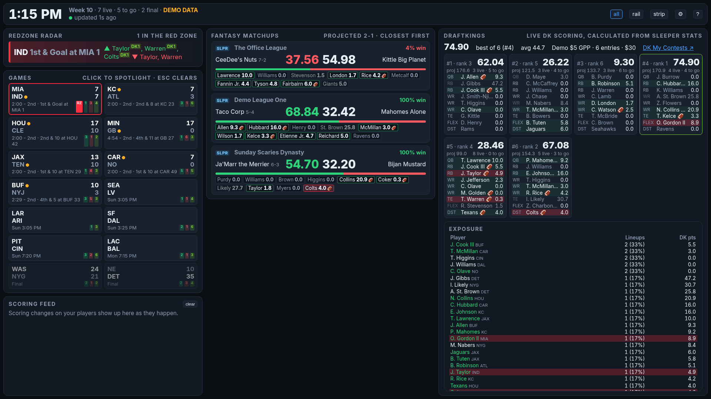
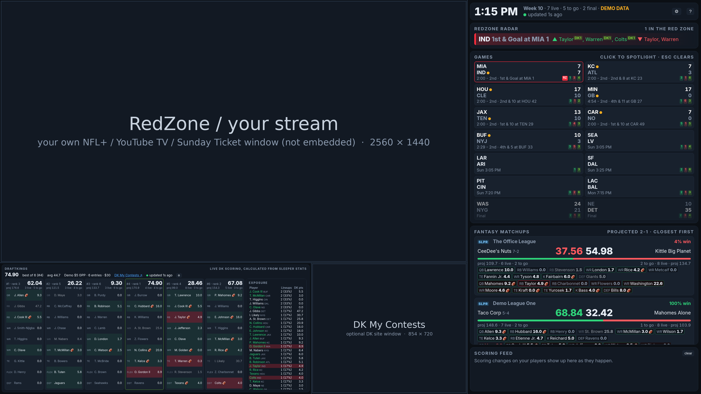

# 🏈 Sunday Command Center

A live NFL Sunday dashboard that sits **next to RedZone** and holds everything else you're sweating:
your fantasy matchups, every game's score and red-zone status, and your DraftKings lineups, all on one screen.

It's a static web page: no install, no account, no server, no build step. Open it on GitHub Pages or
double-click `index.html` from the zip.

## Features

- **RedZone radar**: which offense is inside the 20 right now, and which of *your* players (▲) or your
  opponents' players (▼) are on the field for it.
- **Every game at a glance**: score, clock, down & distance, possession, plus badges that count your Sleeper
  starters (green), your opponents' starters (red) and your DK lineup slots (lime) in each game.
  Click a game (or press `1`–`9`) to spotlight it, and every one of your players in that game lights up.
- **Fantasy matchups (Sleeper + ESPN)**, both in the same card format: live score, live projection, a rough win %, players live / still to play,
  empty-slot warnings, and starter chips that turn red in the red zone and show 🏈 when that team has the ball.
  Sleeper projections follow each league's PPR / half / standard setting. ESPN cards use ESPN's own league
  scoring, live projection and win probability. Closest matchups are listed first.
- **DraftKings lineups**: import your entries CSV, upload CSV or pasted lineups. Live **DK Classic scoring**
  is calculated from Sleeper's live stats (300/100/100 bonuses, DST points-allowed tiers), with best lineup,
  ranks across your entries, players still to play and an exposure table.
- **Scoring feed + toasts**: every scoring change on a player you care about, tagged by whether it helps
  or hurts you, with a big banner for touchdowns. Sound is optional.
- **Layouts**: `all` (one window), `rail` (tall right column) and `strip` (bottom bar) views, plus
  **Display size** presets (Auto / 1080p / 1440p / 4K) that tune fonts, density and the window split.
- **Private by design**: your Sleeper username, ESPN leagues and lineups stay in your browser's `localStorage`.
  Nothing gets uploaded, and there are no API keys.

Try it with fake leagues on live NFL stats: add `?demo=1` to the URL.

## Use it

**Hosted:** `https://<your-github-user>.github.io/sunday-command-center/`
(fork this repo → Settings → Pages → Deploy from branch `main` / root).

**Local / zip:** download the repo zip, unzip, double-click `index.html` (Chrome, Edge, Firefox or Safari).
If your browser is picky about `file://` pages, run `python3 -m http.server` in the folder and open
<http://localhost:8000>.

First run opens **Settings**:
1. **Sleeper**: type your username → *Find me*. Untick any leagues you don't want shown.
   **ESPN**: paste a league ID (or the whole league URL), check the season → *Load teams* → pick your team →
   *Add*. Repeat for as many leagues as you like. Private league? See below.
2. **DraftKings**: drop in one or more CSVs:
   - *Best:* DK → My Contests → Upcoming → **Export to CSV**. This includes contest names, fees and a player/team table.
   - Your bulk **upload CSV** (`QB,RB,RB,WR,WR,WR,TE,FLEX,DST` with `Name (ID)` cells).
   - Optional: **DKSalaries.csv** from the contest lobby (adds teams/salaries for exact matching).
   - Or paste lineups, one per line: `Name (ID), Name (ID), …`
3. **Screen**: RedZone link, display size, zoom, refresh rate, sound.

Views: `index.html?view=rail`, `?view=strip`, `?view=all` (default). Keys: `1–9` spotlight a live game,
`Esc` clear, `s` settings, `r` refresh, `m` sound, `+`/`−` zoom, `?` help.

## ESPN private leagues (optional)

Public ESPN leagues load straight from the page, because ESPN's fantasy API allows cross-origin reads. Private
leagues need two ESPN login cookies, `espn_s2` and `SWID`. A web page can't attach cookies for another site, so
for private leagues the page:

1. tries your browser's own ESPN login (works if you're signed in at espn.com and your browser allows
   third-party cookies), and if that's blocked
2. uses the **tiny local proxy** in [`proxy/`](proxy/): one Python file with no dependencies that runs only on
   your machine (`127.0.0.1`), forwards *only* ESPN fantasy-football league reads, and adds your cookies.

**Run the proxy:** install Python 3 and double-click `proxy/start-proxy.bat` (Windows), or run
`proxy/start-proxy.sh` (Mac/Linux). Leave the window open. It listens on <http://localhost:8766>
(Settings → ESPN → *Test proxy*). If Chrome asks whether the page may access devices on your local network,
click Allow.

**Get `espn_s2` and `SWID`:**
1. Sign in at <https://fantasy.espn.com> in Chrome/Edge/Firefox and open your league.
2. Open DevTools (`F12`, or `Cmd`+`Opt`+`I` on Mac) → **Application** tab (Firefox: **Storage**) → **Cookies** →
   `https://fantasy.espn.com`.
3. Copy the **Value** of `espn_s2` (a long string) and `SWID` (looks like `{XXXXXXXX-XXXX-…}`, braces included).
4. Paste both into Settings → ESPN → *Private ESPN league*. They're saved in this browser's `localStorage` and
   are only ever sent to the proxy on `localhost`. Or put them in `proxy/config.json` instead (copy
   `config.example.json`; the real file is git-ignored).

Treat these cookies like a password: they give read access to your ESPN account's leagues. Never commit or
share them. They expire after a while, so re-copy them if private leagues stop loading.

## Put it next to RedZone

See **[SETUP.md](SETUP.md)** for FancyZones (Windows) and Mac layouts, with exact zone sizes for 4K, 1440p and
1080p. The 4K default looks like this:

There's also a built-in **Open layout windows** button in Settings. It pops out RedZone, rail and strip
windows sized for your display preset (allow pop-ups for the page).

## Data sources

All of these are public, keyless and CORS-enabled, so the page calls them straight from your browser:

| What | Source |
|---|---|
| Leagues, rosters, matchups, live points | `api.sleeper.app/v1` |
| Live player stats, weekly projections, schedule | `api.sleeper.com/stats`, `/projections`, `/schedule` |
| ESPN fantasy leagues, matchups, rosters, live points | `lm-api-reads.fantasy.espn.com/apis/v3/games/ffl` (CORS-enabled; private leagues via the optional local proxy) |
| Scores, clock, possession, red zone | ESPN's public scoreboard (`site.api.espn.com`). If it's unreachable, falls back to Sleeper's schedule (no clock / red zone). |

Refreshes every 15 s by default. These are unofficial endpoints, so they may change or rate-limit without notice.

## Limitations

- **RedZone is not embedded.** NFL+, YouTube TV and Sunday Ticket streams can't be iframed (DRM / frame
  policies), so you run your own stream in its own window and this page sits beside it.
- **DK numbers are calculated, not official.** They come from Sleeper's live stats with DK Classic rules and can
  lag or differ slightly (stat corrections, rare plays). Contest rank, field position and payouts are only in
  DK's My Contests, which needs your login. That's why there's a link and an optional DK window in the layout.
- ESPN: tested against public leagues. The private-league proxy path is tested end-to-end up to ESPN's auth
  check, but not yet with real cookies. IDP and custom ESPN slots show with generic labels.
- Classic NFL contests only (no Showdown/Captain yet). IDP-only Sleeper players show without names.
- Win % is a rough normal-approximation from live projections, not a model.

## Development

No build. `proxy/espn_proxy.py` is the only non-browser piece (optional). `assets/core.js` is pure logic (also runs in Node) and `assets/app.js` is the UI.
Tests: `node --test` (Node 20+; or `node --test test/*.test.js`).

## Disclaimer

Not affiliated with, endorsed by, or sponsored by the NFL, NFL RedZone, Sleeper, ESPN or DraftKings. All
trademarks belong to their owners. This project doesn't embed, restream or proxy any video. It reads publicly
available data for personal use. Respect each service's terms. DFS involves real money: verify everything in
the official apps. MIT licensed, see [LICENSE](LICENSE).
