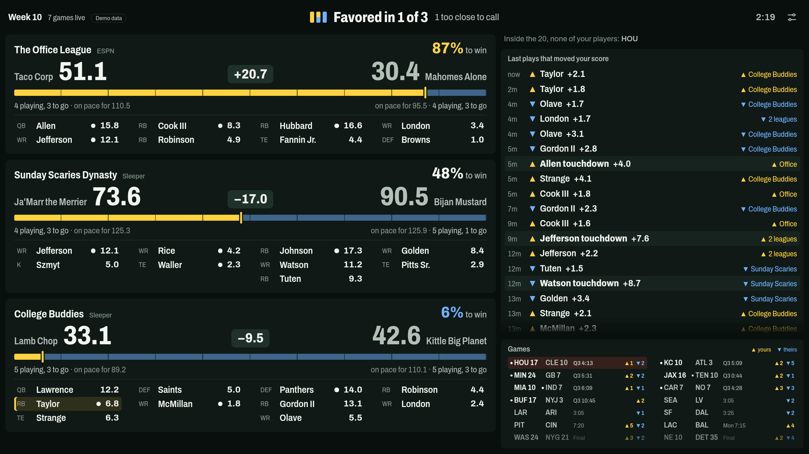
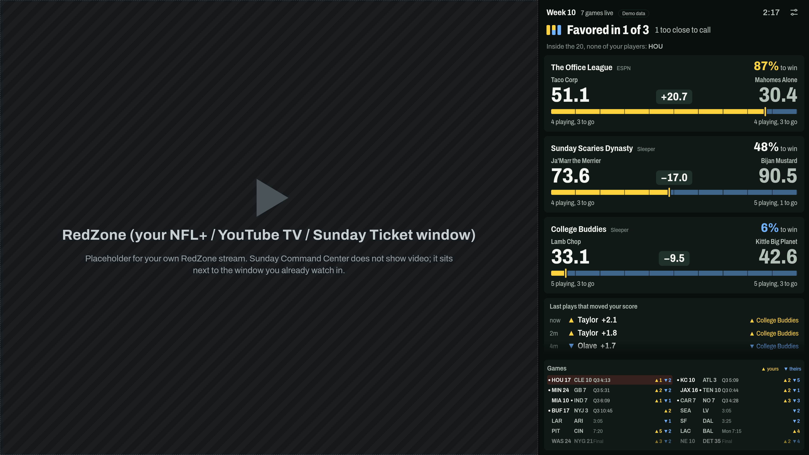
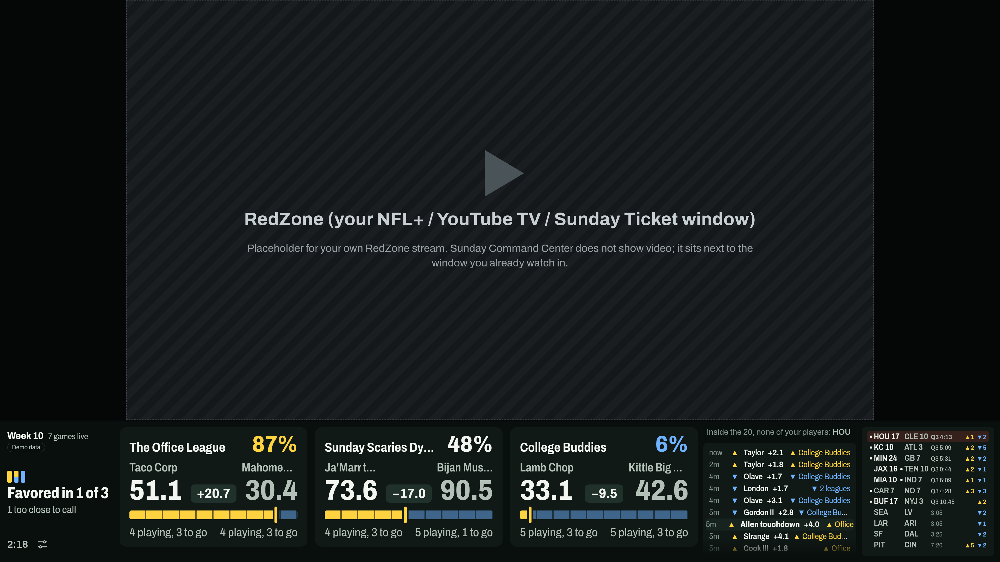
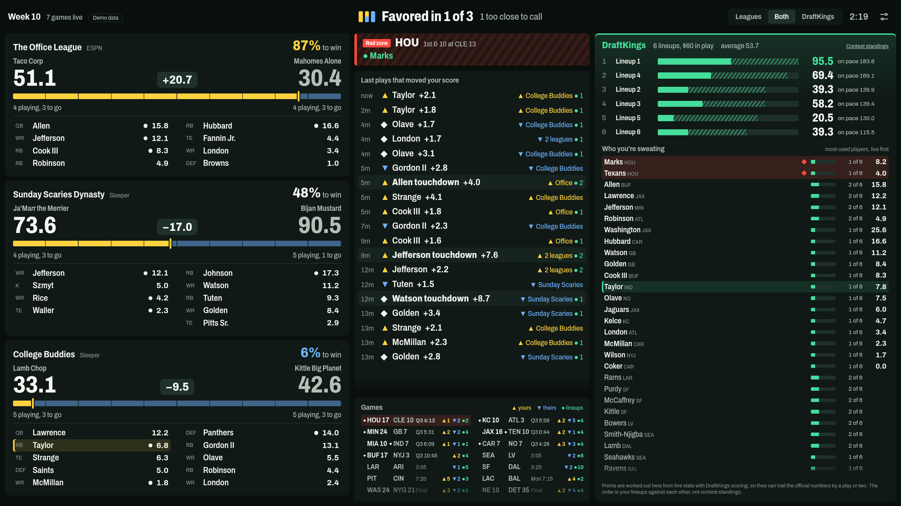
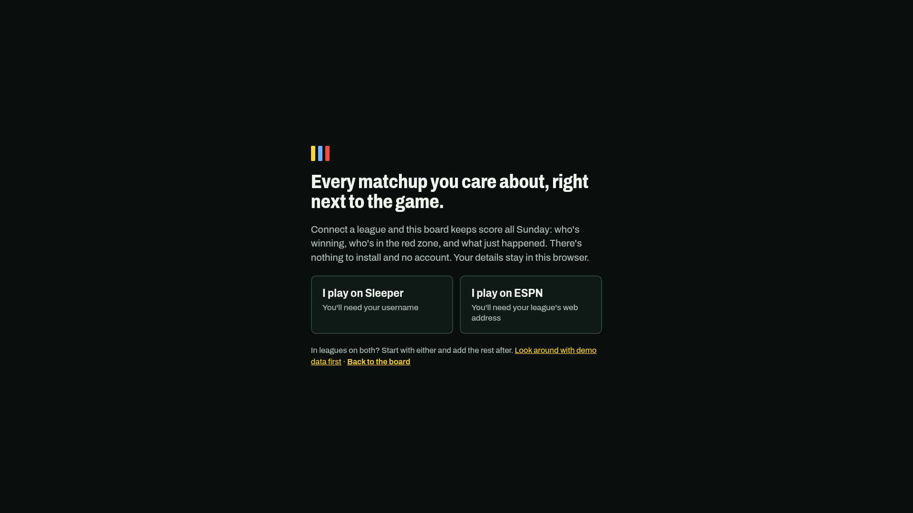

# 🏈 Sunday Command Center

A live NFL Sunday board that sits **next to RedZone** and keeps score of everything else: are you winning your
fantasy matchups, who just scored for or against you, and which of your players are inside the 20 right now.

It's a static web page: no install, no account, no server, no build step. Open it on GitHub Pages or
double-click `index.html` from the zip.

### 👉 [Open the board](https://ewo8om3.github.io/sunday-command-center/) · [Try the demo](https://ewo8om3.github.io/sunday-command-center/?demo=1) · **[Setup guide (SETUP.md)](SETUP.md)**

## Next to RedZone

The board rearranges itself to whatever window you give it. A tall window beside RedZone becomes a **rail**, a
short wide window under it becomes a **strip**, anything else is the full **board**. The grey boxes below stand in
for your own RedZone window (NFL+, YouTube TV, Sunday Ticket or your TV provider); the board never shows video.

1440p versions: [rail](docs/mockup-1440p-redzone-rail.png) · [strip](docs/mockup-1440p-redzone-strip.png) ·
4K with both: [rail + strip](docs/mockup-4k-redzone-rail-strip.png). Exact zone sizes for every screen are in
[SETUP.md §3](SETUP.md#3-layouts).

## What it shows

- **The verdict.** One line at the top: "Favored in 2 of 3", "Too close to call", "Behind in all 3", with one bar
  per league.
- **A card per matchup** (Sleeper and ESPN side by side): both scores, the gap, a win-chance bar and the
  players still to go. Bigger windows add your starters, then your opponent's.
- **Right now:** the play that just moved your score (touchdowns and swings of 5+ points), then every offense
  inside the 20 with **your** players (▲ gold) and **their** players (▼ blue) on that drive.
- **The feed:** every scoring change on a player you care about, newest first, marked by whether it helps or
  hurts you.
- **Games:** every game's score and clock, with how many of your players (▲) and theirs (▼) are in it. Press
  `1`–`9` to outline your players in a live game.

**One colour, one meaning:** gold is yours, blue is theirs, red only ever means the red zone, green only ever
means DraftKings. The shapes ▲ ▼ ◆ ● carry the same meaning for anyone who can't rely on colour.

**Fantasy first.** With only fantasy leagues connected there is no DraftKings anywhere on the page.
**DraftKings is opt-in** (Settings → Daily fantasy): import your lineups and a **Leagues / Both / DraftKings**
switch appears (`D` key). Each window remembers its own choice, so a common setup is a leagues rail and a
DraftKings strip.

**Says so when it's unsure.** The dot next to the clock is filled only when every feed answered on the last
refresh; it goes half when part of the data is old and hollow when nothing is getting through, and hovering it
names the feed. A league that stops answering keeps its last card, tagged **not updating**. When the live game
feed is down, the red-zone slot says **"Red-zone tracking is offline"**, never "nobody's inside the 20".

## Get started

Open the page. It asks one question per screen: Sleeper or ESPN, then your Sleeper username or your ESPN
league's web address (and which team is yours). Add as many leagues as you like; everything stays in this
browser.

- **Sleeper:** your username. Nothing else; Sleeper leagues are public by username.
- **ESPN public league:** paste the league address. Private league? See
  [SETUP.md → Private ESPN leagues](SETUP.md#private-espn-leagues).
- **DraftKings (optional):** Settings → Daily fantasy → drop `DKEntries.csv`, your upload CSV or pasted
  lineups. Live DK Classic points are worked out from Sleeper's live stats; standings and payouts are only on
  DraftKings.

**URLs.** `?view=board|rail|strip` forces a layout (the old `?view=all` still works and means board),
`?show=fantasy|both|dfs` forces a mode, `?demo=1` shows fictional leagues on frozen sample data
(`&dfs=1` adds DraftKings lineups). **Keys:** `S` settings · `D` Leagues / Both / DraftKings · `1`–`9` a live
game · `Esc` clear · `+`/`−` text size · `R` refresh · `M` sound.

**Upgrading from the first version?** Your username, ESPN leagues, lineups, RedZone link, alert and refresh
settings carry over automatically the first time you open the new page. The old "display size" preset is gone:
the layout and the text size now follow each window.

## ESPN's scoreboard and "CORS" (an honest note)

The clock, possession and red zone come from ESPN's public scoreboard (`site.api.espn.com`), read straight
from your browser. ESPN allows that from any website (`Access-Control-Allow-Origin: *`). Tested in Chrome from
the GitHub Pages address and from `localhost`: it works.

What *doesn't* work: **ESPN refuses requests from automated browsers.** Anything whose user agent says
`HeadlessChrome` gets a `403` with no CORS header, which the page sees as "Failed to fetch". That's why earlier
automated reviews saw the scoreboard "blocked by CORS"; a normal browser window doesn't hit it. Ad blockers,
Pi-holes and some corporate networks can block the same address.

If the scoreboard doesn't load:
1. Scores fall back to Sleeper's schedule (scores and status, no clock or red zone). The games list says
   "no clock right now" and the red-zone slot says tracking is offline.
2. If you run the optional helper (`proxy/espn_proxy.py`, below), tick **Also get live game scores through the
   helper** in Settings → Private ESPN helper. The helper fetches the same public scoreboard on your computer.
   No cookies go with it.

## Private ESPN leagues (optional)

Public ESPN leagues and all Sleeper leagues load straight from the page. Private ESPN leagues need two ESPN
login cookies (`espn_s2` and `SWID`), and a web page can't attach another site's cookies, so the page first
tries your browser's own ESPN login and then the small **helper** in [`proxy/`](proxy/): one Python file, no
dependencies, listening only on `localhost:8766`. It forwards only ESPN fantasy-football league reads (plus the
public scoreboard on `/scores`), answers only this site and `localhost` pages, and adds your cookies from
`proxy/config.json` (git-ignored). Step by step: [SETUP.md → Private ESPN leagues](SETUP.md#private-espn-leagues).

Treat those cookies like a password. Never commit, post or screenshot them.

## Data sources

All keyless; the page calls them from your browser. **Only Sleeper's `api.sleeper.app/v1` is officially
documented.** The rest are undocumented and can change or stop at any time.

| What | Source |
|---|---|
| Leagues, rosters, matchups | `api.sleeper.app/v1` |
| Live player stats, projections, schedule | `api.sleeper.com/stats`, `/projections`, `/schedule` |
| ESPN leagues, matchups, live points | `lm-api-reads.fantasy.espn.com/apis/v3/games/ffl` |
| Clock, possession, red zone | `site.api.espn.com` scoreboard; falls back to Sleeper's schedule |

Refresh: your rate (15 s by default) while a game is live, every minute before kickoff on game days, every 5
minutes otherwise. It backs off after errors, pauses in hidden tabs and gives up on any request after 12 s.

## Tested, and not yet

Tested for this release (Chrome on Linux):
- the demo at 4K, 1440p and 1080p in all three layouts, fantasy-only and with DraftKings, with no script errors;
- live data during a real Sunday window: a Sleeper account with several leagues plus a public ESPN league, the
  red-zone slot with a real drive inside the 20, the not-updating tag (one league blocked mid-session, then the
  page reloaded during the outage), everything offline, recovery, the Sleeper fallback with ESPN's scoreboard
  refused, the helper's `/scores` route, and settings carried over from the first version;
- the onboarding with a public ESPN league, a private one (explains the two ways forward), a wrong number and
  an unknown Sleeper name;
- a script-injection check: crafted names (``, `<svg onload>`, quotes) in every league, team,
  owner, player, game and DraftKings field, and `javascript:` / `data:` RedZone links. Nothing ran and nothing
  was injected.

Not tested yet:
- private ESPN leagues with real `espn_s2` / `SWID` cookies (tested up to ESPN's login check);
- Safari, Firefox and Edge with the new design; phones; smart-TV browsers;
- the **Open my Sunday layout** pop-up windows on a real multi-monitor desk;
- sound, and the screen-edge flash during a real touchdown;
- the postseason, DraftKings Showdown (imports with the 1.5× captain, kickers score 0) and the `(LOCKED)` tag on
  a real post-lock DraftKings file;
- IDP and custom ESPN slots show with generic labels.

Win chance is a simple estimate from live projections (ESPN cards use ESPN's own number when it has one).

## Development

No build. `assets/core.js` is the logic (also runs in Node), `assets/app.js` the page, `assets/demo.js` and
`assets/demo-data.js` the demo. Tests: `node --test` (Node 20+). The Archivo font in `assets/fonts/` is under
the SIL Open Font License ([OFL.txt](assets/fonts/OFL.txt)).

## Disclaimer

Not affiliated with, endorsed by, or sponsored by the NFL, NFL RedZone, Sleeper, ESPN or DraftKings. All
trademarks belong to their owners. This project doesn't embed, restream or proxy any video. It reads publicly
available data for personal use. Respect each service's terms. DFS involves real money: verify everything in
the official apps. MIT licensed, see [LICENSE](LICENSE).
