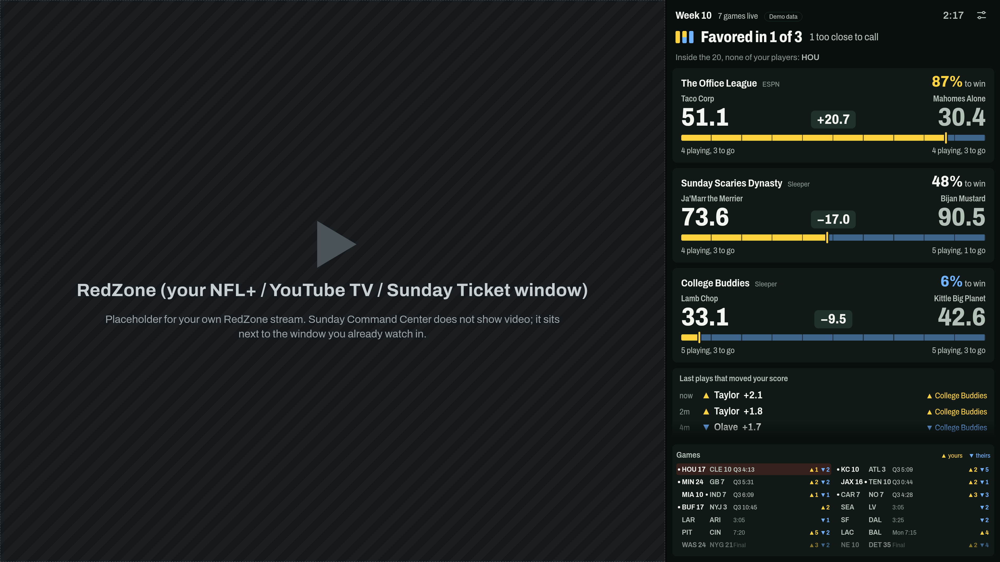
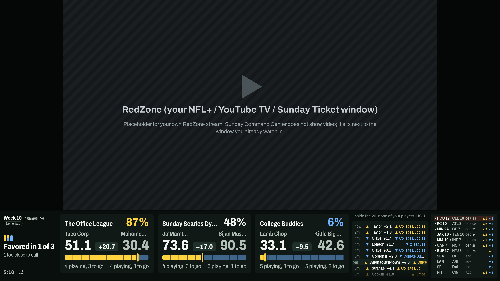
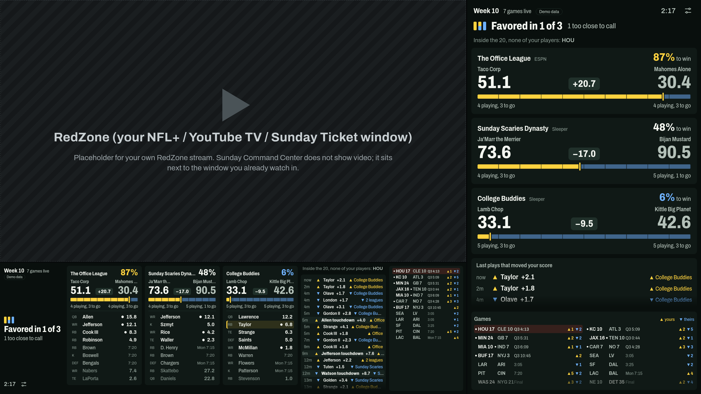

# Sunday Command Center: Setup Guide

This guide covers every way to run the board, how to lay it out next to RedZone on any screen setup,
and how to connect your leagues and (optionally) DraftKings lineups.

> **Menu names change.** Browsers and operating systems rename menus often. Where a path below might differ
> on your version, it's written generically ("the browser menu → install / open as window"). Look for the
> closest match.



---

## Quick start (3 steps)

1. **Open the board:** <https://ewo8om3.github.io/sunday-command-center/>. Nothing to install. Add `?demo=1`
   to the address first if you want a look with fictional leagues.
2. **Connect a league:** the first screen asks Sleeper or ESPN, then your Sleeper username or your ESPN league's
   address. Add more later from Settings (⚙, or press `S`). DraftKings is optional and off until you turn it on.
3. **Put it next to RedZone:** play RedZone in its own window, then put the board in a tall window beside it
   (it becomes the **rail**) and/or a short wide one under it (the **strip**). Sizes for your screen are in
   [Layouts](#3-layouts).

---

## Contents

1. [Ways to run it](#1-ways-to-run-it)
2. [Layouts follow the window](#2-layouts-follow-the-window)
3. [Layouts](#3-layouts): single 4K / 1440p / 1080p, ultrawide 21:9 and 32:9, dual, triple, laptop + TV, tablet/phone
4. [Window snapping](#4-window-snapping): Windows, Mac, Linux
5. [RedZone sources](#5-redzone-sources): getting the stream into its own window
6. [Browser notes](#6-browser-notes)
7. [Connecting leagues](#7-connecting-leagues): Sleeper, ESPN public, [ESPN private](#private-espn-leagues)
8. [DraftKings lineups (optional)](#8-draftkings-lineups-optional)
9. [Troubleshooting](#9-troubleshooting)
10. [FAQ](#10-faq)
11. [Disclaimer](#11-disclaimer)

---

## 1. Ways to run it

The dashboard is a static web page (HTML + JavaScript). It talks straight to the public Sleeper and ESPN data
feeds from your browser. There's no server, no account and no API key.

### A. GitHub Pages link (easiest)

Open <https://ewo8om3.github.io/sunday-command-center/>. Bookmark it, or install it as an app window (see
[§6](#6-browser-notes)). Updates show up automatically.

### B. Download the zip

1. On the GitHub repo page, click **Code → Download ZIP**.
2. Unzip it anywhere, e.g. `Documents\sunday-command-center`.
3. Double-click `index.html`. It opens in your default browser as a `file://` page. Chrome won't load the
   bundled font from a `file://` page, so the board uses a system font there; everything else works. For the
   full look, and for private ESPN leagues through the helper, serve the folder as below instead (the helper
   doesn't answer `file://` pages unless you opt in, see §1.D).

Settings are saved per browser *and* per address, so the zip copy and the GitHub Pages copy have separate
settings.

If a browser refuses to load data from a `file://` page (rare; some locked-down setups do), serve the folder
locally instead. In a terminal in that folder run `python3 -m http.server 8000` (Windows: `py -m http.server 8000`)
and open <http://localhost:8000>.

### C. Clone it (for tinkerers)

```bash
git clone https://github.com/Ewo8om3/sunday-command-center.git
cd sunday-command-center
python3 -m http.server 8000      # or just open index.html
node --test                      # optional: run the tests (Node 20+)
```

To get updates later, run `git pull`.

### D. Optional: the ESPN helper (private leagues, scoreboard backup)

You only need this for **private ESPN leagues**, or if ESPN's live scoreboard won't load in your browser (see
[§9](#9-troubleshooting)). Public ESPN leagues and all Sleeper leagues work without it. It's one Python file
(`proxy/espn_proxy.py`) with no dependencies. It runs only on your computer at `http://localhost:8766` and
forwards nothing but ESPN fantasy-football league reads and, on `/scores`, ESPN's public NFL scoreboard (without
cookies).

**Check that Python 3 is installed**

- **Windows:** open *Command Prompt* or *PowerShell* and run `py --version` (or `python --version`). You should
  see `Python 3.8` or newer. If not, install it from <https://www.python.org/downloads/> and tick **"Add
  python.exe to PATH"** in the installer. You can also get it from the Microsoft Store.
- **Mac:** open *Terminal* and run `python3 --version`. If macOS offers to install the Command Line Developer
  Tools, accept, or install Python from python.org.
- **Linux:** `python3 --version`. It's preinstalled on almost every distro.

**Start it**

- **Windows:** double-click `proxy\start-proxy.bat`. A console window opens and says
  `ESPN proxy on http://localhost:8766`. Leave it open during games. If Windows SmartScreen warns about the file,
  choose *More info → Run anyway* (it's a 7-line text file, so open it in Notepad first if you want to check).
- **Mac/Linux:** in Terminal run `cd path/to/sunday-command-center/proxy` and then `./start-proxy.sh`. If it says
  "permission denied", run `chmod +x start-proxy.sh` once, or start it with `python3 espn_proxy.py`. On a Mac you can
  also right-click `start-proxy.sh` → *Open With* → *Terminal*.
- To use a different port, run `SCC_PROXY_PORT=9000 python3 espn_proxy.py` and set
  `http://localhost:9000` in Settings → Private ESPN helper → *Helper*.

**Check it:** Settings → **Private ESPN helper** → **Test** should say *The helper is running*. You can also open
<http://localhost:8766/health> in your browser (`"scores": true` means it has the scoreboard route).

**Who it answers:** only pages served from `https://ewo8om3.github.io`, `http://localhost:<any port>` and
`http://127.0.0.1:<any port>`. Any other website open in your browser gets `403`, so it can't use your cookies.
- Your own fork on GitHub Pages: start it with `SCC_ALLOWED_ORIGINS=https://yourname.github.io` (Windows
  PowerShell: `$env:SCC_ALLOWED_ORIGINS="https://yourname.github.io"; py -3 espn_proxy.py`), or add
  `"allowed_origins": ["https://yourname.github.io"]` to `proxy/config.json`.
- `index.html` opened straight from disk (`file://`): set `SCC_ALLOW_FILE=1` or `"allow_file_origin": true` in
  `config.json`. Serving the folder with `python3 -m http.server 8000` is safer and needs no opt-in.

Stop it by closing the window or pressing `Ctrl+C`. Cookie setup is in [§7](#7-connecting-leagues).

---

## 2. Layouts follow the window

There are no presets to pick. Every window of the board looks at its own shape:

| Window shape | Layout | What it shows |
|---|---|---|
| tall and narrow (width less than 0.85 × height) | **rail** | verdict, right-now slot, matchup cards, feed, games, stacked |
| wide and short (width more than 2.5 × height) | **strip** | verdict, matchup cards side by side, right now, feed, games |
| anything in between | **board** | matchup cards on the left; right now, feed and games on the right |

Text scales with the window and never drops below a readable minimum. When a window is too small for
everything, it drops detail in steps instead of shrinking text: first your opponent's players, then yours, then
the games that aren't live. When there's room to spare, the text grows. Settings → Display → **Text size** (or
`+`/`−`) scales the whole thing up or down.

| URL | Effect |
|---|---|
| `?view=board`, `?view=rail`, `?view=strip` | force a layout (the old `?view=all` still works and means board) |
| `?show=fantasy`, `?show=both`, `?show=dfs` | force Leagues / Both / DraftKings (only once DraftKings is on) |
| `?demo=1` | fictional leagues on sample data; add `&dfs=1` for DraftKings lineups |
| `&week=10`, `&season=2026` | force a week (see [§9](#9-troubleshooting)) |

You can open the board in several windows. They share settings, and each window remembers its own Leagues /
Both / DraftKings choice.



---

## 3. Layouts

All percentages are of the **whole screen** (width × height) and are measured from the top-left corner. Pixel
values assume the screen's native resolution. RedZone zones are kept at **16:9** so the video fills its zone
without black bars. The board picks rail or strip by itself from the zone's shape.

### 3.1 Single 4K monitor (3840×2160): the default

```
┌──────────────────────────────┬──────────┐
│                              │          │
│        RedZone 16:9          │   rail   │
│        2560 × 1440           │  1280 ×  │
│                              │   2160   │
├──────────────────────────────┤          │
│        strip 2560 × 720      │          │
└──────────────────────────────┴──────────┘
```

| Zone | x, y | Width × height | % of screen |
|---|---|---|---|
| RedZone | 0, 0 | 2560 × 1440 | 66.67% × 66.67% |
| Board as a rail | 2560, 0 | 1280 × 2160 | 33.33% × 100% |
| Board as a strip | 0, 1440 | 2560 × 720 | 66.67% × 33.33% |



Only want one board window? Rail only: RedZone 66.67% × 100% (the video sits in the middle of it) and the rail
beside it. Strip only: RedZone across the top 75% of the screen and the strip along the bottom 25%. Those two
are the pictures in the [README](README.md#next-to-redzone). Playing DraftKings too? Many people set the rail to
Leagues and the strip to DraftKings (press `D` in each window), and keep DraftKings' own My Contests on a phone
for official standings.

### 3.2 Single 1440p monitor (2560×1440)

| Zone | x, y | Width × height | % of screen |
|---|---|---|---|
| RedZone | 0, 0 | 1792 × 1008 | 70% × 70% |
| Rail | 1792, 0 | 768 × 1440 | 30% × 100% |
| Strip | 0, 1008 | 1792 × 432 | 70% × 30% |

1440p pictures: [RedZone + rail](docs/mockup-1440p-redzone-rail.png) · [RedZone + strip](docs/mockup-1440p-redzone-strip.png).

### 3.3 Single 1080p monitor (1920×1080)

| Zone | x, y | Width × height | % of screen |
|---|---|---|---|
| RedZone | 0, 0 | 1440 × 810 | 75% × 75% |
| Rail | 1440, 0 | 480 × 1080 | 25% × 100% |
| Strip | 0, 810 | 1440 × 270 | 75% × 25% |

At this size the rail shows the cards without player rows, and the strip shows one compact row. If you'd
rather have it all at once, put RedZone **fullscreen** on a TV or another monitor and use the full board here
(see 3.6/3.8).

### 3.4 Ultrawide 21:9 (3440×1440 or 2560×1080)

**Option A, video first** (3440×1440):

| Zone | x, y | Width × height | % of screen |
|---|---|---|---|
| RedZone | 0, 0 | 2560 × 1440 | 74.42% × 100% |
| Rail | 2560, 0 | 880 × 1440 | 25.58% × 100% |

**Option B, balanced:**

| Zone | x, y | Width × height | % of screen |
|---|---|---|---|
| RedZone | 0, 0 | 1920 × 1080 | 55.81% × 75% |
| Strip | 0, 1080 | 1920 × 360 | 55.81% × 25% |
| Board | 1920, 0 | 1520 × 1440 | 44.19% × 100% |

On a 2560×1080 ultrawide, use the same percentages.

### 3.5 Super-ultrawide 32:9 (5120×1440 or 3840×1080)

Basically two monitors side by side. Put the video in the middle:

| Zone | x, y | Width × height | % of screen |
|---|---|---|---|
| Rail (Leagues) | 0, 0 | 1280 × 1440 | 25% × 100% |
| RedZone | 1280, 0 | 2560 × 1440 | 50% × 100% |
| Rail or board (DraftKings, or your phone's My Contests) | 3840, 0 | 1280 × 1440 | 25% × 100% |

For 3840×1080, use the same percentages.

### 3.6 Dual monitors

- **Monitor 1 (main or TV-facing):** RedZone **fullscreen** (the player's own fullscreen button, see §5).
- **Monitor 2:** the board maximized or in browser fullscreen (`F11`).
- If monitor 2 is in **portrait** orientation, the board becomes a rail and fills it nicely.

### 3.7 Triple monitors

| Monitor | What goes on it |
|---|---|
| Left | the board as a rail, maximized (portrait orientation is ideal) |
| Center | RedZone fullscreen |
| Right | the board again (with DraftKings on, set this one to DraftKings with `D`), or DraftKings' My Contests |

### 3.8 Laptop beside a TV showing RedZone

- **TV:** play RedZone on the TV itself: a cable box, a streaming stick/box app (YouTube TV, NFL+, your TV
  provider's app), or cast from your phone (§5). The TV doesn't need a browser at all.
- **Laptop:** open the board and press `F11` (Mac: *View → Enter Full Screen*, or `Ctrl`+`Cmd`+`F`). Use
  **Text size** if it's hard to read from the couch.
- Plug the laptop into power, or the screen may dim (see §6 *Keep the screen awake*).

### 3.9 Tablet or phone as a second screen

- Open the GitHub Pages URL on the device. **Settings are stored per device and per browser**, so connect your
  leagues again there. For DraftKings, get the CSV onto the device (AirDrop, email, cloud drive), then Settings →
  Daily fantasy → choose the file, or paste the lineups.
- **Portrait:** the rail. **Landscape tablet:** the board. Phones aren't tested with the new design yet.
- Add it to the home screen for a full-screen, app-like window: iPhone/iPad Safari → *Share → Add to Home Screen*;
  Android Chrome → the menu → *Add to Home screen* / *Install app*.
- The page asks the device to keep the screen on while it's visible (where the browser supports it).
  If the screen still sleeps, raise *Auto-Lock* (iOS) or *Screen timeout*
  (Android) for game day.

---

## 4. Window snapping

### Windows: PowerToys FancyZones (exact zones, recommended)

1. Install **Microsoft PowerToys** (Microsoft Store, or `winget install Microsoft.PowerToys`).
2. Open PowerToys → **FancyZones** → make sure it's enabled.
3. Open the **layout editor**: press `Win`+`Shift`+`` ` `` (backtick), or click *Launch layout editor*.
4. If you have several monitors, pick the monitor at the top of the editor.
5. Choose **Create new layout** → **Canvas** (free-form zones with exact sizes) → name it `Sunday`.
6. Add one zone per row of your layout table in §3 (RedZone, rail, strip, DK). In the Canvas editor, drag or
   resize each zone. Its size is shown on the zone, and the edit dialog lets you type exact values where your
   PowerToys version supports it. Within a few pixels is fine.
   - *Grid alternative:* create a **Grid** layout, then split and merge cells to get roughly the same shape.
7. Save and **apply** the layout to that monitor.
8. To snap a window: start dragging it by the title bar, hold **Shift** (default setting), and drop it on a
   highlighted zone.
9. In FancyZones settings, turn on *"Move newly created windows to their last known zone"* so next Sunday
   your windows go back to their zones.
10. Turn **off** *"Show zone number"* and leave a small zone spacing if you like gaps between windows.

### Windows: built-in Snap (no install)

- **Snap Layouts (Windows 11):** hover the window's maximize button (or press `Win`+`Z`) and pick a layout, e.g.
  the big-left + two-stacked-right layout gives roughly RedZone (left) + rail and strip (right).
- **Keyboard:** `Win`+`←`/`→` snaps to a half, then `Win`+`↑`/`↓` makes a quarter.
- Built-in Snap uses fixed fractions (halves, thirds, quarters), not the exact 16:9 RedZone zones. Use FancyZones
  for a pixel-perfect layout.

### Mac: Rectangle (free)

1. Install **Rectangle** (<https://rectangleapp.com>, or `brew install --cask rectangle`) and give it
   Accessibility permission when asked.
2. Out of the box, use its keyboard shortcuts for halves, thirds ("first two-thirds" for RedZone, "last third"
   for the rail) and "bottom" positions, or drag a window to a screen edge.
3. For exact percentages, use Rectangle's custom-size options (some are in its preferences, more in **Rectangle
   Pro**), or a tool like **Moom** or **Magnet** that accepts custom sizes. Enter the percentages from §3.

### Mac: built-in tiling (macOS 15 Sequoia and later)

- Drag a window to a screen edge or corner and release to tile it. Holding **Option** while dragging shows the
  tile targets right away.
- Or use the menu bar **Window → Move & Resize** for halves, quarters and arrangements, or hover the green
  full-screen button for the same options.
- Like Windows Snap, these are fixed fractions. They're good enough for "RedZone left ⅔, dashboard right ⅓".

### Mac notes

- On a 4K display in a scaled mode ("looks like 1920×1080" or "2560×1440"), windows are measured in scaled
  points, so text comes out the size it would on that smaller screen. Use Settings → Display → **Text size** (or
  `+`/`−`) if you want it bigger.
- `Ctrl`+`Cmd`+`F` (or the green button) puts a window in its own full-screen Space. For tiles, use a zoomed/tiled
  window instead of full screen.

### Linux

- **GNOME:** drag to edges for halves (`Super`+`←`/`→`). For custom zones, install a tiling extension (e.g.
  *Tiling Shell* or *Tiling Assistant*).
- **KDE Plasma:** built-in KWin tiling (`Meta`+`T` opens the tile editor in recent Plasma versions) lets you draw
  custom zones.
- Tiling window managers (i3, sway, Hyprland) can reproduce any table in §3 with splits.

### Built-in fallback: "Open my Sunday layout"

Settings → Display → **Open my Sunday layout** opens the rail, the strip and (if you set a RedZone link) your
RedZone page as pop-up windows, split the way §3 describes for your screen's width (RedZone two-thirds on 4K,
70% on 1440p, 75% on 1080p). Allow pop-ups for the page when the browser asks (usually an icon at the right of
the address bar), then click the button again. Not yet tested on a real multi-monitor desk.

---

## 5. RedZone sources

**RedZone can't be embedded in the dashboard.** All legit RedZone streams use DRM and block being framed by
other sites. So the stream runs in its *own* window and the dashboard sits next to it. The dashboard never
touches the video.

### The general recipe (works for any browser-based source)

1. Open the source's site and start RedZone.
2. Put it in an **app-style window** with no tabs or address bar, so it fits the zone cleanly:
   - **Chrome:** the browser menu (⋮) → *Cast, save, and share* → **Install page as app…**, or *Create
     shortcut…* with **Open as window** ticked. (Older versions: *More tools → Create shortcut*.)
   - **Edge:** the browser menu (…) → *Apps* → **Install this site as an app**.
   - **Safari (macOS 14+):** *File → Add to Dock*.
   - **Firefox:** no built-in "install as app" on most versions. Use a separate window and `F11`, or use Chrome/Edge
     for the video.
   - **Any browser:** the board's Settings → RedZone link + **Open my Sunday layout** opens it as a pop-up
     window without tabs.
3. Snap that window into the RedZone zone (§4).
4. Use the player's **full-window / theater** mode (not full screen) so the video fills the window.
   Pressing the player's **full screen** button takes over the whole monitor. That's what you want on a
   dedicated RedZone monitor or TV, not inside a zone.

### NFL+ Premium (NFL RedZone included)

- In a browser: sign in at NFL+ on nfl.com, open the RedZone channel, and apply the recipe above. Install the
  page as an app in Chrome/Edge so it gets its own window.
- On a TV: use the NFL app on your streaming device or smart TV (see *NFL app* below).

### YouTube TV with the NFL RedZone add-on (or Sunday Ticket)

- In a browser: tv.youtube.com → Live → NFL RedZone. Chrome and Edge both offer **install as app** for YouTube TV,
  which gives a clean window. Double-clicking the video toggles full screen.
- Put `https://tv.youtube.com/` into Settings → Display → RedZone link to get a one-click **RedZone ↗** link in
  the board's header.

### Cable / TV-provider apps (NFL RedZone on Xfinity, Spectrum, DIRECTV, Fubo, Sling and others)

- Many providers have a web player: sign in on the provider's website, find the NFL RedZone channel, and apply
  the recipe. Some providers only allow RedZone in their TV/box apps. In that case use the **laptop + TV**
  layout (§3.8).
- Some web players block full-window mode or need a specific browser. Try Chrome or Edge first.

### The NFL app (phones, tablets, streaming devices)

- On a phone or tablet, play RedZone (with NFL+ Premium) and **cast** or **AirPlay** it to the TV (below), then run
  the dashboard on your computer or another tablet.
- On a streaming device or smart TV, open the NFL app directly on the TV.

### Casting to a TV

- **Chromecast / Google TV:** from the provider's app or Chrome, use the Cast icon. In Chrome, the menu → *Cast…*
  → *Cast tab* mirrors a tab (quality depends on your Wi-Fi). Casting from the provider's own app is smoother.
- **AirPlay:** from an iPhone/iPad/Mac app, tap AirPlay and choose the TV.
- Some providers block casting or mirroring of DRM streams. If you get a black screen, use the TV's own app.
- Once RedZone is on the TV, the computer screen is free for the full board.

---

## 6. Browser notes

| Browser | Notes |
|---|---|
| **Chrome** | Best tested. Install as app / open as window for clean zones. On a GitHub Pages copy, Chrome may ask to allow access to devices on your local network the first time the page reaches the optional ESPN helper. Allow it. |
| **Edge** | Same engine as Chrome, so everything works the same. *Apps → Install this site as an app*. "Sleeping tabs" can pause background tabs (see below). |
| **Firefox** | Works. No install-as-app on most versions; use a separate window + `F11`. Strict tracking protection doesn't block the data feeds, but if a feed fails, check the shield icon in the address bar. |
| **Safari** | Works on Mac, iPhone and iPad. *File → Add to Dock* (macOS 14+) for an app window. Private-league ESPN login via your browser's cookies usually won't work in Safari (it blocks third-party cookies), so use the helper. |

**Full screen:** `F11` on Windows/Linux, `Ctrl`+`Cmd`+`F` on Mac (or *View → Enter Full Screen*). For tiled zones,
skip browser full screen and use an app-style window instead.

**Text size:** the board sizes its text from each window, so a bigger zone means bigger text, and it never goes
below a readable minimum; when space runs out it shows less detail instead of shrinking. To make everything
bigger or smaller, use Settings → Display → **Text size** (or `+`/`−`), which is saved. Browser zoom
(`Ctrl`/`Cmd` + `+`/`−`/`0`) also works, but it's remembered per site and applies to every window of the board.

**Keep the tab running:**
- Chrome: *Settings → Performance → Memory Saver*: add the dashboard's site to "Always keep these sites active".
- Edge: *Settings → System and performance → Sleeping tabs*: add the site to "Never put these sites to sleep".
- Background tabs may refresh less often in any browser. Keep each view in its own visible window.

**Keep the screen awake:**
- The page uses the browser's Screen Wake Lock (Chrome, Edge, Safari 16.4+, recent Firefox) while it's visible. A
  playing video usually keeps the screen awake too.
- Otherwise, raise the OS sleep timer for game day: Windows *Settings → System → Power* (screen and sleep
  timeouts), or PowerToys **Awake**; Mac *System Settings → Lock Screen / Displays*, or run `caffeinate -d` in
  Terminal; phones as in §3.9.

---

## 7. Connecting leagues

You can mix platforms: all your Sleeper leagues plus any number of ESPN leagues appear as cards side by side,
each labelled **Sleeper** or **ESPN**. The first time you open the page it walks you through one league; add more
from Settings → **Your leagues** → *Add a league*. Remove one there too (removed Sleeper leagues can be brought
back).

### Sleeper

1. Choose **I play on Sleeper** and type your **username** (the @handle on your Sleeper profile, not your email)
   → **Find my leagues**.
2. Every league you're in this season is added. Remove any you don't want from Settings → Your leagues.
3. Nothing else is needed. Sleeper data is public by username, no password.

### ESPN public league

1. Open your league at fantasy.espn.com and copy the address from the top of the browser. It looks like
   `https://fantasy.espn.com/football/league?leagueId=12345678&seasonId=2026`. The league number on its own
   works too.
2. Choose **I play on ESPN**, paste it → **Find my league**.
3. Pick **your team**. If you pasted your team page's address (it has `teamId=`), your team is marked "from your
   link".

Whether a league is public is set by the league manager in ESPN's league settings (usually something like
"Make league viewable to public"). If ESPN can't find the league, the page says so; because ESPN answers a wrong
number in a way browsers can't read, a wrong number and a network problem look the same, so double-check the
address first.

### Private ESPN leagues

If the page says **This league is private**, there are two ways forward:

1. **Easiest:** ask your commissioner to make the league viewable to the public (League Settings → Basic
   Settings). Nothing else to set up.
2. **Keep it private** and run the helper on this computer, with your two ESPN login cookies, **`espn_s2`** and
   **`SWID`**.

Before the helper, the page tries your browser's own ESPN login. That works if you're signed in at espn.com in the
same browser and the browser allows third-party cookies (Safari and Brave usually don't).

Using the helper:

1. Start it (§1.D). Settings → **Private ESPN helper** → **Test** should say *The helper is running*.
2. Sign in at <https://fantasy.espn.com> and open your league.
3. Copy the two cookie values:
   - **Chrome / Edge:** press `F12` (or the browser menu → *More tools → Developer tools*) → **Application** tab →
     left sidebar **Storage → Cookies** → select `https://fantasy.espn.com` (or `https://www.espn.com`) → find
     `espn_s2` and `SWID` in the list → double-click the **Value** cell and copy it.
   - **Firefox:** press `F12` → **Storage** tab → **Cookies** → `https://fantasy.espn.com` → copy the Value
     of each.
   - **Safari:** first enable the developer menu (*Safari → Settings → Advanced → "Show features for web
     developers"*, called *"Show Develop menu"* on older versions). Then *Develop → Show Web Inspector* →
     **Storage** tab → **Cookies** → copy the values.
4. **Recommended:** copy `proxy/config.example.json` to `proxy/config.json`, put the two values there and restart
   the helper. Leave the boxes in the page empty. `config.json` is git-ignored.
   Or paste them into Settings → Private ESPN helper: **espn_s2** (a long string) and **SWID** (looks like
   `{ABCDEF12-3456-...}`, braces included).
5. Add the league again (Settings → Your leagues → *Add a league* → ESPN) and pick your team.

> **Security note:** `espn_s2` and `SWID` act like a logged-in session for **your ESPN account**. Anyone who has
> them can read your leagues, and possibly do more, as you. Never post them, screenshot them, commit them or share
> them. Each person uses their own. If you paste them into the page, they're stored in your browser's
> `localStorage` for that page's address and sent only to a helper at `localhost` / `127.0.0.1` (the page refuses
> any other helper address). On the hosted GitHub Pages copy that storage is shared by every project page under
> the same `github.io` account, so `proxy/config.json` is the safer place. To revoke them, sign out of ESPN on
> all devices (or change your password). They also expire on their own, so re-copy them if private leagues stop
> loading.

Status: the private path is tested up to ESPN's login check, not yet with real cookies.

---

## 8. DraftKings lineups (optional)

Off until you turn it on. With it off there's no DraftKings anywhere on the page. DraftKings has no public API for
your entries, so you give the board a file. It stays in your browser.

### Turn it on and import

Settings → **Daily fantasy** → tick **Track my DraftKings lineups**, then drop a file on the box (or choose
one), or open **Or paste lineups**:

| Source | How to get it | What it adds |
|---|---|---|
| **Entries file `DKEntries.csv` (best)** | DraftKings website (desktop) → **Lineups** → **Edit Entries** → pick the NFL slate → **Download**. DK renames menus from time to time; you want the bulk "edit entries" download, the same file you'd upload back to DK. | lineups + contest name, fee, entry IDs + a player/team table |
| **Upload CSV** | the file you edit for DK's bulk lineup upload (`QB,RB,RB,WR,WR,WR,TE,FLEX,DST` with `Name (ID)` cells) | lineups |
| **DKSalaries.csv** (optional) | contest lobby → the contest → *Export to CSV* / download player list | exact teams + salaries for matching |
| **Paste** | one lineup per line: `Name (ID), Name (ID), …` in QB, RB, RB, WR, WR, WR, TE, FLEX, DST order, or the CSV itself | lineups |

A file with lineups replaces the lineups you had; a salary file on its own just improves matching. You can drop
several files at once. Once lineups are in, a **Leagues / Both / DraftKings** switch appears in the header
(`D` key), and each window remembers its own choice.

The import message lists anything it couldn't use: players it couldn't match (add DKSalaries.csv), slots it
couldn't read (shown as "not in the file" on the lineup, whose total is then too low until you re-export), and
Showdown files (1.5× captain applied, kickers score 0, so treat totals as rough). After kickoff DraftKings is
reported to tag started players `Name (ID) (LOCKED)`; the tag is ignored (not yet checked on a real post-lock
file).

### Each week

1. After you finalize lineups (or after late swap), export again from DK and drop the new file in.
2. Not playing DFS this week? Untick **Track my DraftKings lineups** (your lineups are kept) or *Remove them*.

The feed resets with the NFL week automatically. What the DraftKings view shows: live DK Classic points worked
out from Sleeper's stats (300/100/100 yard bonuses, fumble recoveries, DST points-allowed tiers once that DST's
game has kicked off), lineups ranked against each other, who you're sweating (your most-used players, live first)
and players still to go. **Contest standings and payouts are only on DraftKings.**

---

## 9. Troubleshooting

| Symptom | Fix |
|---|---|
| **The dot by the clock is half-filled / "Some data 40s old"** | One feed is failing, so part of the board is older. Hover the dot to see which. It retries on its own (slower after repeated errors). A league that stopped answering keeps its last card with a **not updating** tag. |
| **Hollow dot / "Offline" / the board greys out with "Scores stopped updating"** | Nothing fresh is getting through. Check your connection, then turn off ad/tracker blockers *for this page* (uBlock, Privacy Badger, Brave Shields, a Pi-hole, a corporate firewall). The page needs `api.sleeper.app`, `api.sleeper.com`, `site.api.espn.com` and (ESPN leagues) `lm-api-reads.fantasy.espn.com`. |
| **"Red-zone tracking is offline" / games say "no clock right now"** | ESPN's live scoreboard isn't loading, so scores come from Sleeper's schedule (no clock, possession or red zone). Usually temporary. ESPN allows the page to read it from any site, but it refuses **automated browsers** (a user agent containing `HeadlessChrome` gets a 403), and blockers or networks can block `site.api.espn.com`. If it persists in your normal browser, run the helper (§1.D) and tick Settings → Private ESPN helper → **Also get live game scores through the helper**. |
| **Paused while hidden** | The tab was hidden or asleep; it refreshes as soon as it's visible again. Press `R` to refresh now, and exclude the site from Memory Saver / Sleeping tabs (§6). |
| **Slow refreshes with no games on** | Normal. With no game live it checks every 5 minutes (every minute on game days before kickoff), then switches back to your refresh rate. Press `R` any time. |
| **A lineup says "not in the file" / totals too low** | A slot couldn't be read from the file (see §8). Re-export `DKEntries.csv`, or paste that lineup. |
| **Helper says "origin or host not allowed"** | The page isn't on an allowed address (§1.D). Use the GitHub Pages link or `http://localhost`, or add your fork's address. |
| **Player shows 0 while you can see he scored** | The live stats feed can lag a play or two. Give it 15–30 s. Stat corrections after games can change totals. |
| **"This league is private"** | See [Private ESPN leagues](#private-espn-leagues). If it was public last year, check the season in the address. |
| **"ESPN rejected the login cookies"** | The cookies expired or were copied wrong (SWID needs its `{braces}`). Re-copy both. |
| **"Couldn't load league …"** | Either the number isn't an ESPN league for this season or ESPN isn't answering. Check the address. If ESPN works in another tab, the number is the likely culprit. |
| **"No helper at …" / "the helper isn't running"** | The helper window isn't open, or it's on another port. Start it (§1.D). On a GitHub Pages copy in Chrome, allow the local-network permission prompt. |
| **Wrong week** | The week comes from Sleeper's NFL state and flips early in the week. To force one, add `?week=10` (and optionally `&season=2026`) to the URL. |
| **Sleeper "doesn't have a user called …"** | Use the username (handle), not the display name or email. |
| **DraftKings players unmatched** | Add DKSalaries.csv, or check spelling in pasted lines. DST can be the nickname ("Colts") or full name. |
| **Pop-up windows don't open** | Allow pop-ups for the page (address-bar icon), then click *Open my Sunday layout* again. |
| **Text too small/big** | Settings → Display → **Text size**, or `+`/`−`. Make sure browser zoom is 100% (`Ctrl`/`Cmd`+`0`). |
| **Reset everything** | Settings → **Forget everything on this browser** (tap twice). Or clear site data for the page in the browser settings. Settings for the zip copy and the GitHub Pages copy are separate. |

---

## 10. FAQ

**Is it free? Do I need an account?** Yes and no. It's free and open source (MIT). You just need your Sleeper
username and/or ESPN league IDs.

**Does it upload my data anywhere?** No. Everything is stored in your browser (`localStorage`). The page only
*reads* from Sleeper, ESPN and (if you run it) the helper on your own computer.

**Can it show the RedZone video inside the dashboard?** No. DRM-protected streams can't be embedded in other
pages. Run the stream in its own window next to it (§5).

**I only play season-long fantasy. Do I need the DraftKings stuff?** No. Leave Settings → Daily fantasy off
and nothing about DraftKings appears anywhere.

**Are the DraftKings points official?** No. They're calculated from live Sleeper stats with DK Classic scoring
rules, and are usually spot-on during games. Your official score, rank and winnings are only on DraftKings.

**Does it support Yahoo, NFL Fantasy, CBS, FanDuel or DK Showdown?** Not yet. Sleeper, ESPN and DK Classic.
Showdown files import with the 1.5× captain applied, but kickers score 0, so treat Showdown totals as rough.

**Will the data feeds keep working?** Hopefully, but no promises. Only Sleeper's `api.sleeper.app/v1` API is
officially documented. Sleeper's stats, projections and schedule feeds and both ESPN APIs are undocumented and can
change or be blocked at any time. The board keeps its traffic light (slower when nothing is live) to stay a
polite client.

**Can my buddies use it?** Yes. Send them the GitHub Pages link. Everyone enters their own leagues, and nothing is
shared between people.

**Why does a matchup's projection differ from Sleeper's or ESPN's app?** Sleeper cards use Sleeper's weekly
projections scaled by game time remaining. ESPN cards show ESPN's own projection next to it. The win % is a
simple estimate, not either app's model (except ESPN cards, which use ESPN's own win probability when ESPN
provides it).

**Can I run it on a TV browser?** It's a normal web page, so smart-TV browsers that support modern JavaScript can
load the board. Text entry is painful there, so set it up on a phone or computer first. Note that settings don't
transfer between devices.

---

## 11. Disclaimer

Sunday Command Center is an independent fan project. It is **not affiliated with, endorsed by, or sponsored by**
the NFL, NFL RedZone, NFL+, Sleeper, ESPN, DraftKings, YouTube TV, or any TV provider. All trademarks belong to
their owners. It does not embed, restream, record or proxy any video. It reads publicly available sports and
fantasy data for personal use. You're responsible for following each service's terms. Daily fantasy involves
real money: always verify lineups, scores and results in the official apps. Provided "as is" under the
[MIT License](LICENSE), without warranty of any kind.
